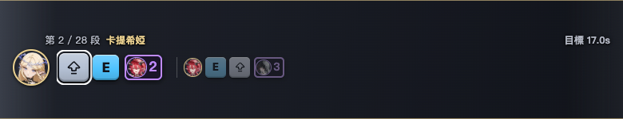
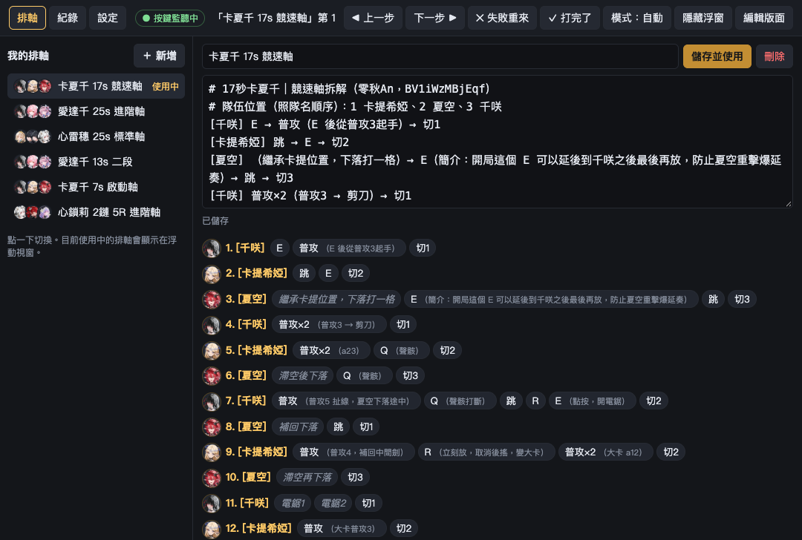

# WW Rotation Overlay（鳴潮排軸提示浮動視窗）

把隊伍的排軸（技能順序）寫成一行行文字，程式會在遊戲畫面上方顯示一個**半透明、滑鼠可穿透、永遠置頂**的小視窗：顯示「現在該按什麼」和接下來幾步，並且**看你的按鍵自動前進**到下一步。也會自動計時每一輪的軸長，方便練習。





## 下載

到 **[下載頁（最新版）](https://github.com/eric236431/ww-rotation-overlay-releases/releases/latest)**，在下方 **Assets** 選一個下載：

| 檔案 | 說明 |
| --- | --- |
| `WW-Rotation-Overlay-Setup-x.y.z.exe` | **安裝檔（推薦）**。點兩下就裝好，桌面和開始選單會有捷徑。**之後有新版會在程式裡自動更新。** |
| `WW-Rotation-Overlay-x.y.z-portable.exe` | 免安裝，單一執行檔直接點兩下。**不會自動更新**（有新版時程式會提示，要自己重新下載）。 |
| `WW-Rotation-Overlay-x.y.z-win-x64.zip` | 免安裝資料夾版，解壓後執行 `WW Rotation Overlay.exe`。一樣不會自動更新。 |

`latest.yml`、`.blockmap` 是自動更新用的，不用下載。只支援 Windows（64 位元）。

### 自動更新（安裝版）

程式開啟時和每 6 小時會檢查一次，有新版就在背景下載。下載好後編輯器上方會出現「新版 vX.Y.Z 已準備好」和這版更新了什麼：

- 按「**重新啟動並更新**」：程式會關掉、更新、自動開回來。
- 按「**稍後**」：先繼續用，**關閉程式時自動更新**，下次開就是新版。
- 「設定 → 更新」可以手動「檢查更新」，或關掉「自動檢查更新」。

## 第一次開啟

1. **SmartScreen**：這個程式沒有付費的程式碼簽章，Windows 可能會跳出「Windows 已保護您的電腦」。按「**其他資訊**」→「**仍要執行**」。
2. **UAC（使用者帳戶控制）**：會問「是否允許此 App 變更您的裝置」，按「**是**」。
   - 為什麼需要系統管理員權限：鳴潮本身以系統管理員權限執行，Windows 會擋住一般權限的程式讀取它的按鍵（浮窗看得到，但不會自動前進）。本程式拿這個權限**只用來讀按鍵**。
   - 按了「否」也能開，但遊戲裡的按鍵讀不到，編輯器上方會出現紅色提示，按「以系統管理員重新啟動」即可。
3. 開啟後有兩個視窗：
   - **編輯器**：寫排軸、切換隊伍、改設定。關掉編輯器 = 結束程式；打遊戲時把它最小化就好。
   - **浮動視窗**：預設在螢幕上方中間。按 `F11` 可以拖曳移動、拖右下角縮放，再按一次 `F11` 固定。
4. 想確認有沒有讀到按鍵：「設定 → 按鍵測試」會即時列出最後收到的按鍵。

## 遊戲設定

遊戲的顯示模式用「**無邊框視窗**」或「**全螢幕**」都可以，浮動視窗會蓋在遊戲上面。

## 快捷鍵

預設如下，可以在「設定 → 快捷鍵」修改（也可以設成滑鼠側鍵 Mouse4 / Mouse5）。

| 按鍵 | 功能 |
| --- | --- |
| `F6` | 上一步 |
| `F7` | 下一步（手動） |
| `F8` | 失敗重來（這場記成「失敗」，回到第一步） |
| `End` | 打完了（這場記成「完成」，回到第一步） |
| `F9` | 顯示 / 隱藏浮動視窗 |
| `F10` | 切換 自動 / 手動 模式（手動模式只看快捷鍵） |
| `F11` | 編輯版面（移動 / 縮放浮動視窗） |
| `Home` | 切換浮窗樣式（A → B → C） |

## 加自己的排軸

程式內建幾套排軸（愛達千、心雷穗、卡夏千、心鎖莉…），也可以在編輯器按「＋ 新增」自己寫。格式很簡單：

```
# 隊伍名稱
@隊伍 心 漂泊者 穗穗
[穗穗] E → Q → 普攻×3 → 切2
[漂泊者] 變奏 → E → R → 切3
@循環
[心] 變奏 → 重擊 → E → 普攻×4 → R（括號裡是備註）
```

- `#` 開頭的第一行是標題；`[角色名]` 開始一段，角色名會自動顯示頭像（可以用簡稱，例如 `[千]`、`[卡提]`）。
- 步驟用 `→` 或 `->` 分隔。常用動作：`普攻`、`普攻×3`、`重擊`、`E`、`Q`、`R`、`切1`/`切2`/`切3`、`變奏`、`跳`、`閃避`。
- 括號 `（ ）` 裡的字只顯示、不用按。
- `@隊伍 1號位 2號位 3號位`：切人時顯示要切去的角色頭像（不寫也會自動推）。
- `@循環` 放在某段前面：打完最後一步會自動跳回這段，分開計時每一圈。
- `@目標 25`：目標軸長（秒）。
- 寫錯時編輯器會用紅字標出第幾行哪裡錯；編輯器下方的「格式說明」有完整寫法。
- 遊戲裡改過按鍵的話，到「設定 → 遊戲按鍵」同步。

## 風險說明

- 本程式**只讀取**鍵盤和滑鼠事件來判斷進度：**不會送出或模擬任何按鍵**、**不會讀寫遊戲記憶體或檔案**、不做任何自動操作，只負責顯示文字。
- 原理跟官方授權的桌寵、按鍵顯示類工具一樣（在遊戲上面疊一個視窗），但任何全域鍵盤監聽工具都**無法保證不被防作弊系統標記**。風險很低但不是零，**使用風險請自負**。

## 版權

- 角色頭像與遊戲美術的版權屬於 **Kuro Games（庫洛遊戲）**。
- 本工具是**非官方的粉絲作品**，與 Kuro Games 沒有關係。
